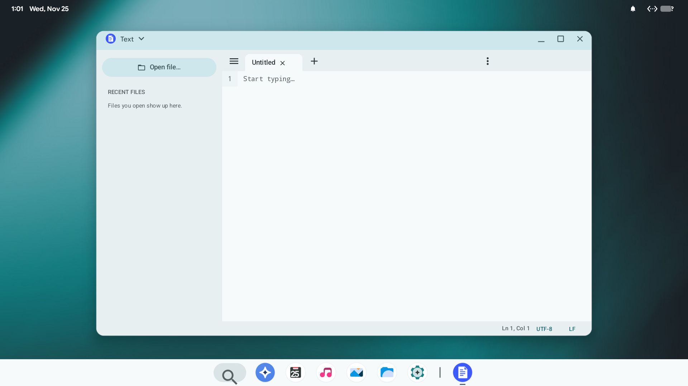

# PcTextEditor ("Text")

Plain text editor for LineageOS for PCs (`lineage_pc_x86_64`), the counterpart of Googlebook's Text app. A
normal (non-privileged) Kotlin + Jetpack Compose + Material 3 app, package `org.lineageos.pctexteditor`.

| Part | Where | What |
|---|---|---|
| `PcTextEditor` | `src/`, `res/` | the Compose app (`android_app`, `product_specific`, `sdk_version: "current"`) |
| `PcTextEditorCore` | `core/` | the editor's logic in plain Kotlin, tested on the host; also used by PcViewer for text decoding |

## What it does

- **One window, one tab per file.** Files opened from other apps (`VIEW`/`EDIT` of `text/*`, JSON, XML,
  JavaScript, shell scripts) arrive as new tabs (`launchMode="singleTask"`); a file already open is selected
  instead of opened twice. Shared text (`SEND text/plain`) opens in a new untitled tab. Tabs show `name *` while
  unsaved; closing one asks Save / Don't save / Cancel.
- **Sidebar**: "Open file…" and the recent files (newest first, "Last viewed today/yesterday/on <date>",
  remove from the list). Access is kept with persistable URI permissions when the picker allows it.
- **Open and save through the system file picker** (`ACTION_OPEN_DOCUMENT`, `ACTION_CREATE_DOCUMENT`). Save writes
  in place (`"wt"`); Save as suggests the tab name plus `.txt` when it has no extension.
- **Find and replace** in a floating card: match count (`2/7`), previous/next (wrapping), match case, whole word
  (Unicode-aware), Replace, Replace all. All matches are highlighted; the current one is scrolled into view.
- **Line numbers** in a gutter that follows word wrap (numbers sit on the first visual line of each text line;
  only visible numbers are drawn). **Word wrap** on or off (off: the text scrolls sideways).
- **Encodings**: detection from BOM (UTF-8, UTF-16 LE/BE), UTF-16 without BOM (zero byte pattern), valid UTF-8,
  else Windows-1252. UTF-16 read without a BOM is written back without one. The status bar offers "Reopen with
  encoding" and "Save with encoding" (UTF-8, UTF-8 BOM, UTF-16 LE/BE with or without BOM, Windows-1252,
  ISO-8859-1). Text the chosen encoding can't hold offers saving in UTF-8.
- **Line breaks**: LF, CRLF or CR detected (most common wins, ties go to LF), edited as LF and written back as the
  file had them; changeable in the status bar.
- **Open policy**: binary files are refused, files over 2 MiB ask first, files over 32 MiB are refused.
- **Syntax highlighting** (on by default) for Kotlin, Java, C, C++, Python, shell, JSON, XML, HTML, CSS,
  JavaScript, TypeScript, Markdown, YAML, INI and Makefile, chosen from the file name (extension, or names such
  as `Makefile` and `.bashrc`). Each language is a rule table in `core/.../SyntaxLanguages.kt`; the tokenizer
  runs off the main thread after each pause in typing and colours the text through an output transformation, so
  editing and undo are untouched. Light and dark palettes; texts over one million characters stay plain.
- **Drafts**: the open tabs, their unsaved text and the file's saved text are kept in the app's private files
  (`files/drafts`) a second after each change and when the window leaves the screen. They come back on the next
  start, also after the system ends the process; clean file tabs are read again from their files.
- **Auto save** (setting, off by default): tabs with a file are written back two seconds after typing stops. It
  never asks, so text the encoding can't hold waits for a manual save.
- **Changes by other apps**: while the window is in front, open files are checked every five seconds (date and
  size from the provider, or a content hash when it reports neither). A clean tab is reloaded as an edit (undo
  brings the old text back); a tab with changes asks: load the new version, keep mine, or save mine as a copy.
  A file that disappears is reported once.
- **Settings**: theme (system/light/dark), font size (10 to 28 sp), line numbers, word wrap, sidebar on start,
  syntax highlighting, auto save.
- **Shortcuts**: Ctrl+N/T new tab, Ctrl+O open, Ctrl+S save, Ctrl+Shift+S save as, Ctrl+W close tab, Ctrl+F find,
  Ctrl+H replace, F3/Ctrl+G and Shift+F3/Ctrl+Shift+G next/previous match, Ctrl+Tab and Ctrl+Shift+Tab between
  tabs. Undo and redo (Ctrl+Z) come from the Compose text field, with one history per tab.
- Texts in English (`res/values`) and Brazilian Portuguese (`res/values-pt`).

Googlebook's Text was used only as a layout reference (screen structure: tab strip, sidebar with recent files,
find/replace card with match count, settings sections). No code, images, fonts or icons were taken from it; the
launcher icon is our own vector and the UI icons come from the Material icons library in the tree.

## Tests

```sh
core/run_tests.sh                       # 103 JUnit tests of the core, with external/kotlinc and JUnit from prebuilts
python3 -m unittest discover -s tests   # UI strings: both languages, same placeholders, no em dash
tools/typecheck.sh                      # compiles core + Compose UI against the androidx prebuilts and the public SDK
```

`tools/typecheck.sh` needs the coroutines jar of a previous build in `out/soong/.intermediates`; it builds no APK.
In Soong the core tests are `PcTextEditorCoreTests` (`java_test_host`, `atest`-able).

## Build integration

- `device.mk`: `PRODUCT_PACKAGES += PcTextEditor`
- local manifest: `<project path="packages/apps/PcTextEditor" name="android_packages_apps_PcTextEditor" remote="pc" revision="lineage-24.0" />`

## Limits

- Never built with Soong or run on a device: only the host tests and the host typecheck have run.
- Highlighting is per language with regular expressions: languages embedded in others (CSS or JavaScript inside
  HTML) are not coloured as such.
- Changes by other apps are found by checking every five seconds while the window is in front: document
  providers don't send change notifications for arbitrary files, so there is nothing to listen to.
- Every file opens as a tab of the single window (Googlebook also uses tabs).

## Screenshots

Taken in QEMU/KVM at 1920x1080 from the live ISO.



Text editor with a new file.

## License

Apache License 2.0, see [LICENSE](LICENSE). Copyright 2026 Mateus Seiboth. Third-party code keeps its own
license (see Credits).

## Credits

This app is part of LineageOS for PCs and builds on:

- [LineageOS](https://lineageos.org) ([GitHub](https://github.com/LineageOS)): the platform and build tree.
- [The Android Open Source Project](https://source.android.com): the framework, the Kotlin compiler and the
  Jetpack Compose and AndroidX prebuilts it is built with.

Thanks to everyone behind these projects. Files taken from them keep their original licenses and copyright notices.
